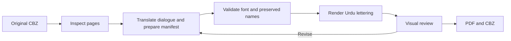

# Urdu Manga Skill

**Urdu dialogue, original manga artwork, English names, and untouched action lettering.**

A reusable Codex skill and local Python workflow for translating and lettering comic dialogue in Urdu. It grew out of an English-to-Urdu chapter conversion and the user's corrections about names, sound effects, and Nastaliq typography.

This project packages the workflow and renderer. A translator or assistant still reads the pages, writes the Urdu dialogue, selects regions, and reviews the result.



## What it preserves

- Original panel order, page proportions, and drawings beneath dialogue overlays.
- English character/place/organization names and named techniques inside dialogue.
- Original standalone attack calls, sound effects, nonverbal cries, captions, titles, credits, and bonus pages.
- Previous editions: writing into a nonempty output directory requires `--overwrite`.

The preferred font in the originating project was **PDMS Nastaliq Nafees Regular**. Supply your own Urdu-capable font file. No manga scans, translated commercial chapters, or font binaries are included.

## Install the skill

Copy `skills/urdu-manga` to your Codex skills directory, typically `~/.codex/skills/urdu-manga`. Restart or refresh skill discovery if required by your client. Invoke it with:

```text
Use $urdu-manga to translate this comic's dialogue into Urdu. Keep names,
attack calls, action sounds, captions, and original artwork unchanged.
```

Read the [skill entry point](skills/urdu-manga/SKILL.md), [complete workflow](skills/urdu-manga/references/workflow.md), and [manifest format](skills/urdu-manga/references/manifest.md).

## Run the local helper

Requires Python 3.10+ and the packages in `requirements.txt`.

```sh
python -m pip install -r requirements.txt
python skills/urdu-manga/scripts/manga.py inspect --source book.cbz --output work/inspection
```

Read the numbered review images and fill the generated manifest with Urdu dialogue and coordinates. Validate it and render a new edition:

```sh
python skills/urdu-manga/scripts/manga.py validate --source book.cbz --manifest dialogue.json --font /path/to/urdu.ttf
python skills/urdu-manga/scripts/manga.py render --source book.cbz --manifest dialogue.json --font /path/to/urdu.ttf --latin-font /path/to/latin.ttf --output output/edition
```

The optional Latin font controls English names; otherwise a built-in sans-serif is used. Useful rendering options:

| Option | Default | Purpose |
| --- | --- | --- |
| `--raster-scale` | `1.5` | Export pixel dimensions relative to the source |
| `--line-height` | `1.65` | Nastaliq line spacing |
| `--min-scale` | `0.45` | Lowest permitted text fitting scale |
| `--weight` | `0.24` | Small overprint offset for stronger regular lettering; `0` disables it |
| `--overwrite` | off | Explicitly permit replacing generated files in the selected output directory |

Outputs: `edition.pdf`, `edition.cbz`, ordered page PNGs, `manifest.json`, `fit-report.json`, and `contact-sheet.png`.

## Try the original sample

The demo is a synthetic comic page created for this repository, not a page from a published manga.

```sh
python examples/make_demo.py --output work/demo
python skills/urdu-manga/scripts/manga.py render --source work/demo/demo.cbz --manifest examples/dialogue.json --font /path/to/urdu.ttf --output output/demo
```

## Improvements over the first one-book script

- Configurable archive, manifest, fonts, and output location; no personal computer paths.
- Exact archive entry names and natural page ordering instead of chapter-specific page IDs.
- Separate text-layout and cleanup rectangles.
- Explicit dialogue/monologue scope and exact preserved-name checks.
- Urdu glyph validation before rendering.
- Correct reverse white lettering, mixed-direction English names, and optional weight adjustment.
- Fresh output directories by default and no archive-path extraction.
- Fitting reports, contact sheets, and PDF/CBZ integrity checks.
- Synthetic examples, behavior tests, and GitHub Actions CI.

## Quality limits

Only image-based CBZ archives are directly supported. OCR, translation, automatic balloon detection, and restoration of artwork beneath lettering are not implemented by the helper. Flat cleanup fills can remain visible over shaded artwork. Automatic fitting can still produce unattractive text; inspect every changed page. The PDF is flattened, so dialogue is not selectable/searchable.

Use source material and fonts you are entitled to process. The code license does not grant rights to third-party manga or font files. Generated local books and fonts are excluded from this repository.

## Development

```sh
python -m unittest discover -s tests -v
```

Contributions should include a reproducible example and a behavior test for the issue. Keep real manga pages, font files, credentials, and personal paths out of commits. See [CONTRIBUTING.md](CONTRIBUTING.md).

## License

GNU AGPL v3.0 or later. Third-party packages retain their own licenses; see [THIRD_PARTY_NOTICES.md](THIRD_PARTY_NOTICES.md).
